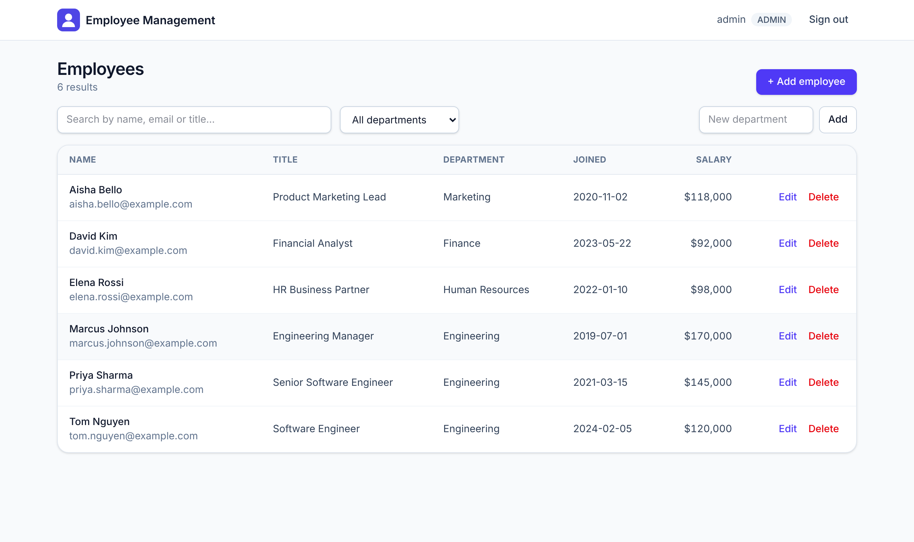
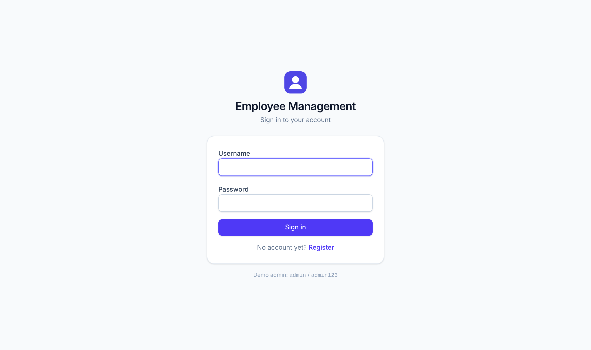
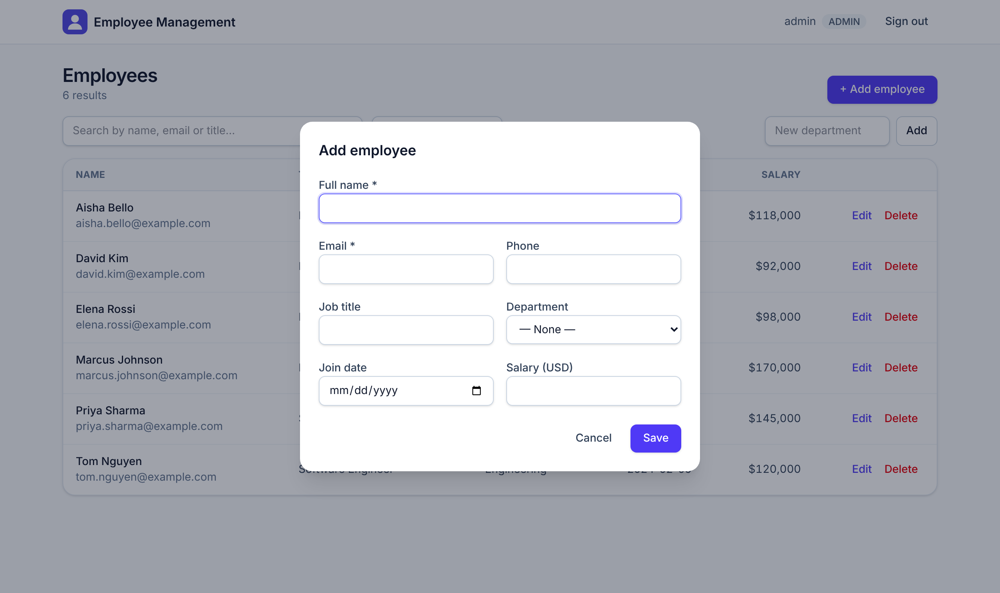

# Employee Management System

[](https://github.com/aniketnandi/Employee-Management-System/actions/workflows/ci.yml)


[](LICENSE)

A full-stack employee directory with JWT authentication, role-based access control, and search. It runs as a
**FastAPI** REST API, a **React + TypeScript** single-page app, and a **PostgreSQL** database, all started with one
Docker Compose command.

I first built this in my undergrad with PHP and MySQL. This is a full rewrite on a modern, typed, tested stack.



## Features

- **JWT authentication**: OAuth2 password flow, bcrypt password hashing, and tokens that expire.
- **Role-based access control**: `admin` and `hr` users can create, edit, and delete records. Self-registered
  `employee` accounts are read-only, and the API enforces this, not just the UI.
- **Employee CRUD**: name, email, phone, job title, department, join date, and salary, with server-side validation.
  Duplicate emails and unknown departments are rejected.
- **Search and filtering**: case-insensitive search across name, email, and title, a department filter, and pagination.
- **Department management**: create and delete departments. Deleting one unassigns its employees.
- **Database migrations** with Alembic. The schema is versioned, not created on the fly.
- **Demo data seeding**, so the app is usable right after `docker compose up`.
- **Interactive API docs** (Swagger UI) at `/docs`.
- **Automated tests and CI**: pytest covers auth, permissions, CRUD, and search. GitHub Actions runs the tests, the
  linter, and the frontend build on every push.

## Tech Stack

| Layer    | Technologies                                                                      |
| -------- | --------------------------------------------------------------------------------- |
| Frontend | React 19, TypeScript, Vite, Tailwind CSS v4, React Router, Axios                   |
| Backend  | Python 3.12, FastAPI, SQLAlchemy 2.0, Pydantic v2, Alembic, python-jose, passlib  |
| Database | PostgreSQL 16 (SQLite works for quick local development and tests)                |
| Tooling  | Docker Compose, pytest, ESLint, GitHub Actions                                    |

## Architecture

```
┌──────────────────────┐   HTTP + JSON     ┌──────────────────────────┐   SQLAlchemy   ┌──────────────┐
│  React SPA (Vite)    │ ───────────────▶  │  FastAPI  /api/v1        │ ─────────────▶ │  PostgreSQL  │
│  Login · Employees   │  Bearer JWT       │  auth · employees ·      │                │              │
│  Axios interceptors  │ ◀───────────────  │  departments             │ ◀───────────── │  (Alembic)   │
└──────────────────────┘                   └──────────────────────────┘                └──────────────┘
```

```
backend/
  app/
    api/            # Route handlers (v1) and shared auth/permission dependencies
    core/           # Settings loaded from environment variables
    db/             # Engine, session, and declarative base
    models/         # SQLAlchemy ORM models
    schemas/        # Pydantic request/response models
    services/       # Password hashing, JWT handling, demo-data seeding
  alembic/          # Database migrations
  tests/            # pytest suite (in-memory SQLite)
frontend/
  src/
    components/     # Route guard, employee form modal
    lib/            # API client, auth token storage, shared types
    pages/          # Login/Register and Employees dashboard
```

## Getting Started

### Option 1: Docker Compose (recommended)

You need [Docker](https://docs.docker.com/get-docker/).

```bash
git clone https://github.com/aniketnandi/Employee-Management-System.git
cd Employee-Management-System
docker compose up --build
```

| Service      | URL                          |
| ------------ | ---------------------------- |
| Web app      | http://localhost:5173        |
| API          | http://localhost:8000        |
| API docs     | http://localhost:8000/docs   |

Sign in with the seeded demo admin account: **`admin` / `admin123`**.

### Option 2: Run locally without Docker

Backend (Python 3.12+). It uses SQLite by default, so you don't need a database server:

```bash
cd backend
python -m venv .venv && source .venv/bin/activate
pip install -r requirements-dev.txt
cp .env.example .env
alembic upgrade head
uvicorn app.main:app --reload
```

Frontend (Node 20+), in a second terminal:

```bash
cd frontend
npm install
npm run dev
```

### Configuration

The backend reads these environment variables. See [`backend/.env.example`](backend/.env.example).

| Variable                       | Default                       | Description                                         |
| ------------------------------ | ----------------------------- | --------------------------------------------------- |
| `DATABASE_URL`                 | `sqlite:///./ems.db`          | SQLAlchemy connection string                         |
| `SECRET_KEY`                   | insecure dev value            | Key for signing JWTs. **Set this in any real deployment.** |
| `ACCESS_TOKEN_EXPIRE_MINUTES`  | `60`                          | Token lifetime                                       |
| `CORS_ORIGINS`                 | `http://localhost:5173`       | Comma-separated list of allowed frontend origins     |
| `SEED_DEMO_DATA`               | `false` (`true` in Compose)   | Create the demo admin account and sample employees on startup |

## API Overview

All endpoints are under `/api/v1`. Full request and response schemas are at `/docs`.

| Method   | Endpoint                 | Access          | Description                                   |
| -------- | ------------------------ | --------------- | --------------------------------------------- |
| `POST`   | `/auth/register`         | Public          | Create a read-only employee account           |
| `POST`   | `/auth/login`            | Public          | Exchange username and password for a JWT      |
| `GET`    | `/auth/me`               | Authenticated   | Current user profile                          |
| `GET`    | `/employees/`            | Authenticated   | List employees (`q`, `department_id`, `skip`, `limit`) |
| `GET`    | `/employees/{id}`        | Authenticated   | Get one employee                              |
| `POST`   | `/employees/`            | Admin / HR      | Create an employee                            |
| `PUT`    | `/employees/{id}`        | Admin / HR      | Update an employee (partial updates allowed)  |
| `DELETE` | `/employees/{id}`        | Admin / HR      | Delete an employee                            |
| `GET`    | `/departments/`          | Authenticated   | List departments                              |
| `POST`   | `/departments/`          | Admin / HR      | Create a department                           |
| `DELETE` | `/departments/{id}`      | Admin / HR      | Delete a department                           |

## Testing

```bash
cd backend && pytest -v                      # API tests
cd frontend && npm run lint && npm run build # type checking, lint, production build
```

## Screenshots

| Login | Add / edit employee |
| ----- | ------------------- |
|  |  |

## Possible Next Steps

- Refresh tokens and an admin screen for promoting users to the `hr` role
- Server-side sorting and paginated responses with total counts
- Frontend unit tests (Vitest + React Testing Library)
- A production Docker image that serves the built frontend through Nginx

## License

Released under the [MIT License](LICENSE).
